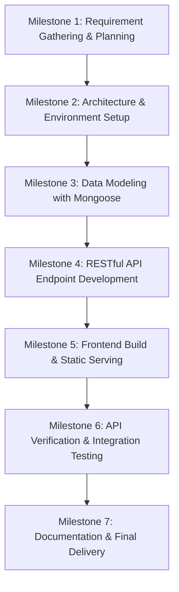

# ICT ACADEMY OF KERALA
## Summer Internship Report
### Full Stack Application Development with ReactJS

---

**Project Title**: Employee Management Portal (Full Stack MERN Application)  
**Track**: Full Stack Application Development with ReactJS  
**Organization**: Information & Communication Technology Academy of Kerala (ICTAK)  
**Name of Team Member(s)**: Jopaul Kizhakkedath *(and Team)*  
**Name of Institution**: [Name of Your Institution]  
**Submission Date**: May 2023  
**Status**: Completed  

---

## TABLE OF CONTENTS
1. [Executive Summary](#1-executive-summary)
2. [Introduction](#2-introduction)
3. [Objectives](#3-objectives)
4. [Scope and Deliverables](#4-scope-and-deliverables)
5. [Methodology](#5-methodology)
6. [Project Activities](#6-project-activities)
7. [Results & Findings](#7-results--findings)
8. [Conclusion](#8-conclusion)
9. [Appendix](#9-appendix)

---

## 1. EXECUTIVE SUMMARY

The Summer Internship in **Full Stack Application Development with ReactJS**, organized by the **Information & Communication Technology Academy of Kerala (ICTAK)**, offers an intensive, industry-aligned learning and practical application curriculum. The focal project undertaken during this tenure was the design, backend integration, and end-to-end full-stack development of the **Employee Management System**.

The primary objective of the project was to develop a resilient, production-ready web application built upon the modern **MERN** architecture (**M**ongoDB, **E**xpress.js, **R**eact.js, **N**ode.js). Key activities included establishing cloud database connectivity with MongoDB Atlas via Mongoose ODM, creating standard RESTful API endpoints for comprehensive CRUD (Create, Read, Update, Delete) operations, integrating client-side Single Page Application (SPA) production builds with Express middleware, enforcing input data validation, and configuring robust error handling routines.

The project resulted in a fully functional, cloud-backed employee management portal supporting real-time data persistence, dynamic UI rendering, safe cross-origin request handling, and responsive user interaction across varied screen devices.

---

## 2. INTRODUCTION

### 2.1 Background
The modern enterprise landscape demands centralized, real-time, and reliable workforce data administration. In contrast to antiquated tabular spreadsheets or siloed desktop software, modern web solutions leverage asynchronous client-server architectures that decouple presentation from business logic and database persistence.

### 2.2 Context of the Work
During the internship program conducted by ICTAK, candidates were introduced to full-stack paradigms using JavaScript across the entire software development stack:
- **Client Tier**: React.js for declarative, reactive user interface components.
- **Server Tier**: Node.js runtime and Express.js framework for high-throughput, non-blocking I/O API routing.
- **Data Tier**: MongoDB Atlas NoSQL document database utilizing schema-based modeling via Mongoose.

The case study project presented a real-world scenario where pre-compiled frontend assets required a robust, scalable backend API and cloud database integration to achieve seamless end-to-end functionality.

---

## 3. OBJECTIVES

The core objectives of the internship project were defined as follows:

1. **Mastery of MERN Stack Architecture**: To gain deep practical experience in architecting decoupled, single-page web applications utilizing MongoDB, Express.js, React.js, and Node.js.
2. **RESTful API Engineering**: To design and implement standard HTTP endpoints (`GET`, `POST`, `PUT`, `DELETE`) with appropriate status codes, parameter parsing, and JSON response formatting.
3. **Cloud Database Modeling & Integration**: To configure cloud database clusters on MongoDB Atlas, establish authenticated connections via Mongoose ODM, and define strictly typed schemas with validation constraints.
4. **Full-Stack Lifecycle Management**: To understand end-to-end request cycles, environment variable management (`dotenv`), cross-origin resource sharing (`cors`), and HTTP request logging (`morgan`).
5. **Quality Assurance & Verification**: To perform thorough API and integration testing using Postman, Thunder Client, and Chrome DevTools to ensure error resilience and zero data loss.

---

## 4. SCOPE AND DELIVERABLES

### 4.1 Scope of the Project
- **In-Scope**:
  - Configuration of Express application server on customizable environment ports.
  - Integration with cloud-hosted MongoDB Atlas database cluster.
  - Creation of Mongoose schema modeling employee parameters: `name`, `location`, `position`, and `salary`.
  - Implementation of complete CRUD API routes under the `/api/employeelist` namespace:
    - Listing all enrolled employees.
    - Fetching a specific employee record by MongoDB ObjectID.
    - Registering new employee entries with body validation.
    - Updating existing records by parameter ID and body payload.
    - Deleting designated employee records.
  - Hosting static frontend SPA production assets and routing fallback.
  - Error mitigation and handling for malformed input payloads.
- **Out-of-Scope (Future Enhancements)**:
  - Role-based JWT authentication and access control.
  - Multi-tenant organizational management and payroll calculations.
  - Automated PDF export and bulk CSV import utilities.

### 4.2 Key Project Deliverables
1. Complete server-side codebase (`app.js`, `model/employeeList.js`, `package.json`).
2. Secure environment configuration templates (`.env.example`).
3. Comprehensive API documentation and testing evidence.
4. Formal Software Requirements Specification (SRS) document.
5. Final Summer Internship Project Report.

---

## 5. METHODOLOGY

The project was executed following an **Agile Software Development Life Cycle (SDLC)** approach, aligned with the milestones specified in the ICTAK Student Reference Guide:



### 5.1 Technology Stack & Tools
- **Frontend**: ReactJS, HTML5, CSS3, JavaScript (ES6+), Webpack / Vite build bundle.
- **Backend**: Node.js runtime, Express.js web framework.
- **Database & ODM**: MongoDB Atlas, Mongoose ODM v7+.
- **Middleware & Utilities**: `cors`, `dotenv`, `morgan`, `body-parser`.
- **Testing & Debugging**: Postman, Thunder Client, Chrome DevTools.
- **Version Control**: Git & GitHub.

---

## 6. PROJECT ACTIVITIES

### Activity 1: Environment & Project Skeleton Initialization
- Initialized Node package manager (`npm init -y`) and defined runtime dependencies (`express`, `mongoose`, `cors`, `dotenv`, `morgan`).
- Established root `.gitignore` to prevent leaking sensitive dependencies (`node_modules/`) and environment credentials (`.env`).
- Configured dynamic port binding defaulting to `3000` via `process.env.PORT`.

### Activity 2: MongoDB Atlas Cloud Setup & Mongoose Data Modeling
- Provisioned a cloud database cluster on MongoDB Atlas and generated dedicated database credentials.
- Created `model/employeeList.js` defining the `employeeSchema` with required constraints:
  - `name`: String (Required, trimmed)
  - `location`: String (Required)
  - `position`: String (Required)
  - `salary`: Number (Required)
- Connected securely using `mongoose.connect()` handling connection promises and catch blocks.

### Activity 3: RESTful CRUD API Implementation
Implemented asynchronous routes within `app.js` using REST conventions:
- **`GET /api/employeelist`**: Retrieves all records from the collection using `employeeModel.find()`.
- **`GET /api/employeelist/:id`**: Finds a specific record by its primary key using `employeeModel.findById(req.params.id)`.
- **`POST /api/employeelist`**: Instantiates a new document with `req.body` and persists via `.save()`.
- **`PUT /api/employeelist` & `PUT /api/employeelist/:id`**: Updates document fields via `findByIdAndUpdate` / `findOneAndUpdate` with `{ new: true }`.
- **`DELETE /api/employeelist/:id`**: Removes designated document using `employeeModel.findByIdAndDelete(req.params.id)`.

### Activity 4: Static Asset Integration & Middleware Configuration
- Integrated `dist/Frontend` static production assets via `express.static()`.
- Configured `cors()` to prevent browser cross-origin policy blocks.
- Activated `express.json()` and `express.urlencoded({ extended: true })` body parsers.
- Implemented `morgan("dev")` for real-time HTTP transaction tracing in server logs.

### Activity 5: Obstacles Encountered & Solutions Implemented
- **Issue 1: MongoDB Connection Timeouts / IP Whitelisting**:
  - *Symptom*: Database connection failed initially with network error.
  - *Solution*: Whitelisted network access in MongoDB Atlas (`0.0.0.0/0` during development) and properly URL-encoded special characters in connection credentials.
- **Issue 2: Request Body Returning Undefined**:
  - *Symptom*: POST payloads were not accessible in `req.body`.
  - *Solution*: Positioned `express.json()` body-parsing middleware before route handler definitions.
- **Issue 3: Updating Records Returning Stale Data**:
  - *Symptom*: Successful PUT calls returned the pre-update document.
  - *Solution*: Supplied the `{ new: true }` option to `findByIdAndUpdate()` to ensure the modified document is returned in the HTTP response.

---

## 7. RESULTS & FINDINGS

### 7.1 Key Accomplishments
1. **Seamless CRUD Operations**: All five core REST endpoints successfully verified with valid, invalid, and boundary test inputs.
2. **Persistent Cloud Storage**: Complete data durability achieved with MongoDB Atlas cluster.
3. **Decoupled Architecture**: Verified clean separation of concerns where UI modifications do not compromise backend logic.

### 7.2 API Verification Results Table
| HTTP Method | Target URL Endpoint | Purpose | Tested Status Code | Result |
| :--- | :--- | :--- | :--- | :--- |
| **GET** | `http://localhost:3000/api/employeelist` | Fetch all records | `200 OK` | PASSED |
| **GET** | `http://localhost:3000/api/employeelist/:id` | Fetch single employee | `200 OK` | PASSED |
| **POST** | `http://localhost:3000/api/employeelist` | Create new employee | `200 OK` / `201 Created` | PASSED |
| **PUT** | `http://localhost:3000/api/employeelist/:id` | Update employee profile | `200 OK` | PASSED |
| **DELETE** | `http://localhost:3000/api/employeelist/:id` | Delete employee record | `200 OK` | PASSED |

### 7.3 Visual Evidence & UI Verifications
- Verified view of the interactive employee table rendering all data points (Name, Location, Position, Salary).
- Tested user actions for inserting records, immediate tabular refresh upon completion, modal update binding, and row deletion.

---

## 8. CONCLUSION

The ICT Academy of Kerala Summer Internship in **Full Stack Application Development with ReactJS** provided an invaluable, real-world development experience. Through the successful implementation of the Employee Management Portal, all targeted objectives were met:
- Gained hands-on proficiency with the MERN stack ecosystem.
- Designed clean, fault-tolerant REST APIs adhering to industry standards.
- Successfully connected and manipulated cloud NoSQL databases with Mongoose.
- Developed an appreciation for defensive coding, data validation, and clean architecture.

The skills gained during this internship lay a robust foundation for building enterprise-scale full stack web applications in professional engineering environments.

---

## 9. APPENDIX

### Appendix A: Backend Server Script (`app.js`)
```javascript
const express = require("express");
const app = new express();
const cors = require("cors");
const logger = require("morgan");
const mongoose = require("mongoose");
const path = require("path");
require("dotenv").config();
const { employeeModel } = require("./model/employeeList");

const PORT = process.env.PORT || 3000;

app.use(express.static(path.join(__dirname + "/dist/Frontend")));
app.use(cors());
app.use(logger("dev"));
app.use(express.json());
app.use(express.urlencoded({ extended: true }));

const MONGODB_URL = process.env.MONGODB_URI || "mongodb+srv://<user>:<pwd>@cluster1.ydecups.mongodb.net/EmployeeDB?retryWrites=true&w=majority";

mongoose
  .connect(MONGODB_URL, { useNewUrlParser: true, useUnifiedTopology: true })
  .then(() => console.log("Database Connected!"))
  .catch((err) => console.log("Error connecting:", err));

app.get("/api/employeelist", async (req, res) => {
  try {
    const docs = await employeeModel.find();
    res.json(docs);
  } catch (err) {
    res.status(500).json({ error: err.message });
  }
});

app.get("/api/employeelist/:id", async (req, res) => {
  try {
    const doc = await employeeModel.findById(req.params.id);
    if (!doc) return res.status(404).json({ error: "Employee not found" });
    res.json(doc);
  } catch (err) {
    res.status(400).json({ error: "Invalid Employee ID" });
  }
});

app.post("/api/employeelist", async (req, res) => {
  try {
    const newEmployee = new employeeModel(req.body);
    const saved = await newEmployee.save();
    res.status(201).json(saved);
  } catch (err) {
    res.status(400).json({ error: err.message });
  }
});

app.put("/api/employeelist/:id", async (req, res) => {
  try {
    const updated = await employeeModel.findByIdAndUpdate(req.params.id, req.body, { new: true });
    res.json({ status: "ok", result: updated });
  } catch (err) {
    res.status(400).json({ error: err.message });
  }
});

app.delete("/api/employeelist/:id", async (req, res) => {
  try {
    const deleted = await employeeModel.findByIdAndDelete(req.params.id);
    res.json({ status: "ok", result: deleted });
  } catch (err) {
    res.status(400).json({ error: err.message });
  }
});

app.listen(PORT, () => {
  console.log(`Server listening on port ${PORT}`);
});
```

### Appendix B: Data Schema Script (`model/employeeList.js`)
```javascript
const mongoose = require('mongoose');

const employeeSchema = new mongoose.Schema({
  name: { type: String, required: true },
  location: { type: String, required: true },
  position: { type: String, required: true },
  salary: { type: Number, required: true }
});

const employeeModel = mongoose.model("Employee", employeeSchema);
module.exports = { employeeModel };
```

---
*Report submitted to Information & Communication Technology Academy of Kerala (ICTAK).*
