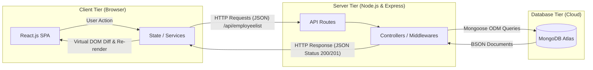

# SOFTWARE REQUIREMENTS SPECIFICATION (SRS)
## Full Stack Application Development with MERN Stack
### ICT ACADEMY OF KERALA (ICTAK) — Summer Internship 2023

---

| **Document Title** | Software Requirements Specification (SRS) |
| :--- | :--- |
| **Project Name** | Employee Management Portal (Full Stack MERN Application) |
| **Course / Program** | Full Stack Application Development with ReactJS |
| **Organization** | Information & Communication Technology Academy of Kerala (ICTAK) |
| **Prepared By** | Jopaul Kizhakkedath *(Team Member / Student)* |
| **Institution** | [Name of Your Institution] |
| **Date** | May 2023 |
| **Version** | 1.0.0 |
| **Status** | Final Submission |

---

## 1. INTRODUCTION

### 1.1 Purpose
The purpose of this Software Requirements Specification (SRS) is to provide a complete, detailed description of the design, functional requirements, non-functional requirements, data models, API contracts, and architectural structure for the **Employee Management System**. This document serves as the formal baseline for development, testing, deployment, and evaluation under the ICT Academy of Kerala (ICTAK) Full Stack Development Internship.

### 1.2 Document Conventions
- **Must / Shall**: Mandatory requirement for the Minimum Viable Product (MVP).
- **Should**: Highly recommended feature implemented or planned in immediate milestones.
- **May**: Optional or future roadmap consideration.
- Technical notations adhere to standard RESTful API conventions and JSON specifications.

### 1.3 Intended Audience
- **ICTAK Academic Evaluators & Mentors**: For validating curriculum compliance, architecture standards, and submission grading.
- **Development Team**: For implementation guidelines, schema design, and API consistency.
- **Quality Assurance / Testers**: For verifying acceptance criteria, test cases, and edge cases.

### 1.4 Project Scope
The Employee Management System is a responsive Single Page Application (SPA) built on the MERN stack (MongoDB, Express.js, React.js, Node.js). It digitizes enterprise employee record keeping, enabling HR personnel and team leads to:
- Monitor and browse workforce directories.
- Search and view detailed employee profiles by unique identifiers.
- Register new employee records with validated designation, location, and compensation parameters.
- Edit and update existing personnel details dynamically.
- Decommission and delete obsolete records with instantaneous UI reflection.

---

## 2. PROJECT DEFINITION & HIGH-LEVEL OVERVIEW

### 2.1 Problem Statement
Many mid-sized enterprises and institutional departments continue to rely on fragmented spreadsheets or disparate legacy tools for tracking employee designations, postings, and compensation. This practice leads to data duplication, concurrency errors, lack of validation, and operational inefficiency. The **Employee Management System** solves this by offering a centralized, cloud-connected, responsive web portal that ensures end-to-end data integrity, rapid retrieval, and structured CRUD operations via a decoupled RESTful API.

### 2.2 Target Users & Roles
| Role | Description | Key Permissions & Responsibilities |
| :--- | :--- | :--- |
| **HR Administrator / Manager** | Primary operational user managing staff records | Full CRUD permissions: Create, Read, Update, and Delete employee profiles. |
| **Department Lead / Viewer** | Supervisory user reviewing team distributions | Read-only permissions: View directory list, search/filter by ID, inspect profile details. |
| **System Administrator** | Platform maintenance and DevOps | Database oversight, API configuration, environment management, and deployment maintenance. |

### 2.3 MVP Scope vs. Future Enhancements
| Category | Minimum Viable Product (MVP) - In Scope | Future Enhancements - Post-MVP Scope |
| :--- | :--- | :--- |
| **Record Management** | Full CRUD for employee records (`name`, `location`, `position`, `salary`). | Department hierarchy trees, bulk CSV import/export. |
| **Search & Filtering** | Direct lookup by ID, listing with instant client-side rendering. | Multi-parameter search (by department, salary bracket, location). |
| **Security & Auth** | CORS protection, payload sanitization, centralized error handling. | JWT-based Role-Based Access Control (RBAC), OAuth 2.0 Google login. |
| **UI Experience** | Responsive SPA, 4-state lifecycle (Loading, Success, Empty, Error). | Dark mode switch, employee avatar uploads (AWS S3 / Cloudinary). |
| **Data Storage** | Cloud-hosted MongoDB Atlas cluster with Mongoose schemas. | Soft-delete audit logging, payroll history tracking. |

---

## 3. USER STORIES & ACCEPTANCE CRITERIA

### 3.1 User Story 1: Directory Listing
- **Story**: *As an HR Administrator, I want to view a comprehensive list of all enrolled employees so that I can monitor organizational staffing at a glance.*
- **Acceptance Criteria**:
  1. Navigating to the home/dashboard triggers a GET request to `/api/employeelist`.
  2. While records are loading, a distinct loading indicator/spinner is shown.
  3. If records exist, display table/cards containing Name, Location, Position, and Salary.
  4. If zero records exist in the database, display a friendly Empty State: *"No employees found. Click 'Add Employee' to create one."*
  5. If the server fails or is unreachable, render an error alert with a "Retry" button.

### 3.2 User Story 2: Employee Registration (Create)
- **Story**: *As an HR Administrator, I want to add a new employee profile with essential job and compensation details so that new hires are immediately indexed.*
- **Acceptance Criteria**:
  1. The form provides input fields for `name` (String), `location` (String), `position` (String), and `salary` (Number).
  2. Submitting with any empty field triggers inline form validation without sending an API call.
  3. Clicking Submit initiates a POST request to `/api/employeelist` with JSON payload.
  4. The submit button is disabled during in-flight submission to prevent duplicate records.
  5. On 201 / success response, display a success toast and update the directory list without requiring a hard browser reload.

### 3.3 User Story 3: Single Employee Lookup
- **Story**: *As a Team Lead, I want to query a single employee by their unique ID so that I can inspect their specific assignment details.*
- **Acceptance Criteria**:
  1. Requesting `/api/employeelist/:id` returns the matching employee object.
  2. If the ID does not match any document, return HTTP 404 with a safe JSON error message (`"Employee not found"`).
  3. Malformed MongoDB ObjectIDs return HTTP 400 Bad Request instead of causing unhandled 500 server crashes.

### 3.4 User Story 4: Employee Information Update (Edit)
- **Story**: *As an HR Administrator, I want to edit an employee’s designation, location, or salary so that records remain accurate upon transfers or promotions.*
- **Acceptance Criteria**:
  1. Clicking "Edit" populates the modal/form with existing employee properties.
  2. Submitting sends a PUT request to `/api/employeelist` or `/api/employeelist/:id`.
  3. Valid modifications return HTTP 200 with the updated document in the response.
  4. The UI reflects the edited values immediately upon successful resolution.

### 3.5 User Story 5: Record Decommissioning (Delete)
- **Story**: *As an HR Administrator, I want to remove an employee record when they leave the organization so that the database remains current.*
- **Acceptance Criteria**:
  1. Each employee entry has a distinct "Delete" action button.
  2. Clicking "Delete" prompts a confirmation dialog to prevent accidental deletion.
  3. Confirming sends a DELETE request to `/api/employeelist/:id`.
  4. Upon receiving HTTP 200/204, the deleted row is smoothly removed from the UI table.

---

## 4. SYSTEM ARCHITECTURE & PROJECT STRUCTURE

### 4.1 MERN Stack Architectural Flow
The system follows a decoupled, three-tier client-server architectural pattern:



### 4.2 Request-Response Lifecycle
1. **User Action**: The client triggers a state change (e.g., clicking "Add Employee").
2. **Frontend Service**: An asynchronous API call is dispatched using `fetch` or `axios` with JSON headers.
3. **Express Middleware**:
   - `cors()` verifies the requesting origin.
   - `express.json()` and `express.urlencoded()` parse incoming request bodies.
   - `morgan('dev')` logs HTTP method, status, and response latency.
4. **Route & Model Execution**: Route invokes corresponding Mongoose ODM methods (`find`, `findById`, `save`, `findOneAndUpdate`, `findByIdAndDelete`).
5. **Database Interaction**: MongoDB Atlas processes the query over TLS/SSL and returns query results.
6. **Controller Dispatch**: Express formats the data and returns standard HTTP status codes (200, 201, 400, 404, 500).
7. **Client Rendering**: React receives JSON payload, updates component state, and updates the DOM.

### 4.3 Directory & Codebase Organization
```text
Employee-App/
├── dist/                          # Production-optimized frontend build
│   └── Frontend/
│       ├── index.html             # Single-page entry document
│       ├── main.*.js              # Compiled React application bundle
│       ├── polyfills.*.js         # Browser compatibility shims
│       └── styles.*.css           # Global stylesheet bundle
├── model/                         # Database schema definition layer
│   └── employeeList.js            # Mongoose Schema & Model export
├── node_modules/                  # Installed dependencies
├── .env                           # Local environment secrets (excluded from Git)
├── .env.example                   # Public environment variable template
├── app.js                         # Express application entry point & routing
├── package.json                   # Dependency definitions & scripts
└── README.md                      # Operational guide and API documentation
```

---

## 5. DATA MODEL & SCHEMA SPECIFICATIONS

### 5.1 Entity: Employee (`employees` collection)
The system data layer is managed via Mongoose ODM connected to MongoDB Atlas.

| Field Name | Type | Constraint | Description | Example |
| :--- | :--- | :--- | :--- | :--- |
| `_id` | `ObjectId` | Auto-generated, Primary Key | Unique MongoDB document identifier | `645f1b2c4e1a2b3c4d5e6f7a` |
| `name` | `String` | Required, Trimmed | Full legal name of the employee | `"Arun Kumar"` |
| `location` | `String` | Required | Office location / branch city | `"Thiruvananthapuram"` |
| `position` | `String` | Required | Job title / designation | `"Frontend Developer"` |
| `salary` | `Number` | Required, Min: 0 | Monthly/Annual compensation figure | `55000` |
| `createdAt` | `Date` | Timestamp (Optional) | Record creation timestamp | `2023-05-15T10:30:00.000Z` |
| `updatedAt` | `Date` | Timestamp (Optional) | Last modification timestamp | `2023-05-15T11:45:00.000Z` |

### 5.2 Mongoose Schema Definition
```javascript
const mongoose = require('mongoose');

const employeeSchema = new mongoose.Schema({
  name: {
    type: String,
    required: [true, 'Employee name is required'],
    trim: true
  },
  location: {
    type: String,
    required: [true, 'Work location is required'],
    trim: true
  },
  position: {
    type: String,
    required: [true, 'Designation / Position is required'],
    trim: true
  },
  salary: {
    type: Number,
    required: [true, 'Salary is required'],
    min: [0, 'Salary cannot be negative']
  }
}, {
  timestamps: true
});

const employeeModel = mongoose.model("Employee", employeeSchema);
module.exports = { employeeModel };
```

---

## 6. API CONTRACT SPECIFICATION (RESTful API)

The backend exposes a standardized RESTful API under the `/api/employeelist` namespace:

### 6.1 Endpoints Matrix
| Method | Endpoint Path | Functionality | Request Body | Expected Success | Common Error Codes |
| :--- | :--- | :--- | :--- | :--- | :--- |
| **GET** | `/api/employeelist` | Retrieve all employee records | None | `200 OK` (JSON Array) | `500 Server Error` |
| **GET** | `/api/employeelist/:id` | Retrieve single employee by ID | None | `200 OK` (JSON Object) | `400 Bad ID`, `404 Not Found` |
| **POST** | `/api/employeelist` | Create new employee profile | JSON Object | `201 Created` (Created Object) | `400 Validation Error` |
| **PUT** | `/api/employeelist` | Update employee profile (Body ID) | JSON Object (with `_id`) | `200 OK` (Updated Object) | `400 Invalid Input`, `404 Not Found` |
| **PUT** | `/api/employeelist/:id`| Update employee profile (Param ID)| JSON Object | `200 OK` (Updated Object) | `400 Bad ID`, `404 Not Found` |
| **DELETE** | `/api/employeelist/:id` | Delete employee record | None | `200 OK` (`{ status: "ok" }`) | `400 Bad ID`, `404 Not Found` |

### 6.2 Sample Payloads & Responses

#### POST `/api/employeelist`
- **Request Headers**: `Content-Type: application/json`
- **Request Body**:
  ```json
  {
    "name": "Ananya Sen",
    "location": "Kochi",
    "position": "UI/UX Designer",
    "salary": 48000
  }
  ```
- **Success Response (`201 Created` or `200 OK`)**:
  ```json
  {
    "_id": "646399f24da030a273b092a1",
    "name": "Ananya Sen",
    "location": "Kochi",
    "position": "UI/UX Designer",
    "salary": 48000,
    "__v": 0
  }
  ```
- **Validation Failure Response (`400 Bad Request`)**:
  ```json
  {
    "error": "ValidationError",
    "message": "Employee validation failed: salary: Path `salary` is required."
  }
  ```

---

## 7. USER INTERFACE & STATE REQUIREMENTS

As specified in the ICTAK Student Reference Guide (Section 7.3), every user interface view mandates support for **Four Fundamental UI States**:

| UI State | Behavioral & Visual Expectation |
| :--- | :--- |
| **1. Loading State** | Displays an animated spinner or skeleton placeholders while HTTP transactions are pending. Action buttons are disabled to prevent double clicks. |
| **2. Success State** | Smoothly renders the active data table with employee rows containing clear Action icons (Edit, Delete). |
| **3. Empty State** | When the collection contains zero records, displays an informative prompt: *"No employee records found. Click 'Add New Employee' to get started."* |
| **4. Error State** | Displays a non-technical, human-readable error banner with a "Retry" CTA when network failures or 500 errors occur. |

---

## 8. NON-FUNCTIONAL REQUIREMENTS (NFRs)

### 8.1 Performance Requirements
- **Page Load Time**: First Contentful Paint (FCP) under 1.5 seconds on broadband connections; Time to Interactive (TTI) under 2.5 seconds.
- **API Latency**: REST API endpoints must respond within 300ms under standard local/cloud network conditions.
- **Lightweight Bundling**: Frontend static production build in `dist/` is optimized and minified.

### 8.2 Security & Privacy Requirements
- **Environment Isolation**: Database credentials (`MONGODB_URI`), JWT secrets, and port parameters are stored exclusively in `.env` and kept out of version control (`.gitignore`).
- **NoSQL Injection Guard**: Parameter validation prevents arbitrary Mongo query operators (`$gt`, `$ne`) from being injected into request parameters.
- **Cross-Origin Resource Sharing (CORS)**: Strict CORS policies restricting API access to designated client origins.
- **Safe Error Emission**: Production responses must never reveal stack traces, database credentials, or server internals to client browsers.

### 8.3 Reliability & Availability
- Graceful error recovery: Unhandled promise rejections or database disconnects must log to the server console without terminating the Node process abruptly.
- Database fallback: Automated reconnect attempts if the MongoDB Atlas connection experiences momentary network interruption.

### 8.4 Usability, Responsiveness & Accessibility
- **Responsive Layout**: Fluid CSS Grid and Flexbox layouts guaranteeing usability across screen widths from 360px (mobile) to 1920px (desktop).
- **Web Content Accessibility Guidelines (WCAG 2.1 AA)**: All form inputs have explicit label associations, contrast ratio >= 4.5:1, and full keyboard tab navigation.
- **Cross-Browser Compatibility**: Validated on Google Chrome, Mozilla Firefox, Microsoft Edge, and Safari.

---

## 9. VERIFICATION, TESTING & ACCEPTANCE MATRIX

| Test ID | Verification Scope | Input Condition | Expected Output | Verification Tool |
| :--- | :--- | :--- | :--- | :--- |
| **TC-01** | GetAll API Verification | GET `/api/employeelist` | HTTP 200, Array of objects with `name`, `location`, `position`, `salary` | Thunder Client / Postman |
| **TC-02** | GetById Valid ID | GET `/api/employeelist/645...` | HTTP 200, JSON object matching requested ID | Thunder Client / Postman |
| **TC-03** | GetById Invalid ID | GET `/api/employeelist/invalid_id` | HTTP 400 or 404, Safe error message | Postman |
| **TC-04** | Create Employee Valid | POST with complete body | HTTP 201/200, record saved in MongoDB Atlas | Postman & Atlas Compass |
| **TC-05** | Create Employee Missing Field | POST without `salary` | HTTP 400 Validation Error, no DB record added | Postman |
| **TC-06** | Update Employee Record | PUT `/api/employeelist` with updated fields | HTTP 200, DB document updated with new values | Postman & Browser UI |
| **TC-07** | Delete Employee Record | DELETE `/api/employeelist/:id` | HTTP 200, document removed from collection | Postman & Browser UI |
| **TC-08** | End-to-End Integration | Full user journey via Browser UI | Data persisted across refresh without console errors | Chrome DevTools |

---

## 10. DEPLOYMENT & HOSTING SPECIFICATION

| Component | Target Environment | Configuration Details |
| :--- | :--- | :--- |
| **Database Tier** | **MongoDB Atlas** | M0 Free Tier Replica Set, Network Access whitelist `0.0.0.0/0` (or host IPs), Dedicated DB User with ReadWrite permissions. |
| **Backend API** | **Render / Railway / Local Node.js** | Long-running Node service, Node runtime v18.x+, environment variables configured via host dashboard. |
| **Frontend Client** | **Static Express Host / Vercel** | Bundled SPA from `dist/Frontend`, configured SPA fallback routing to `index.html`. |
| **Security & HTTPS** | **SSL / TLS Certificate** | All traffic forced over HTTPS protocol in production. |

---

*Prepared for submission to the ICT Academy of Kerala (ICTAK) Learning Portal.*
